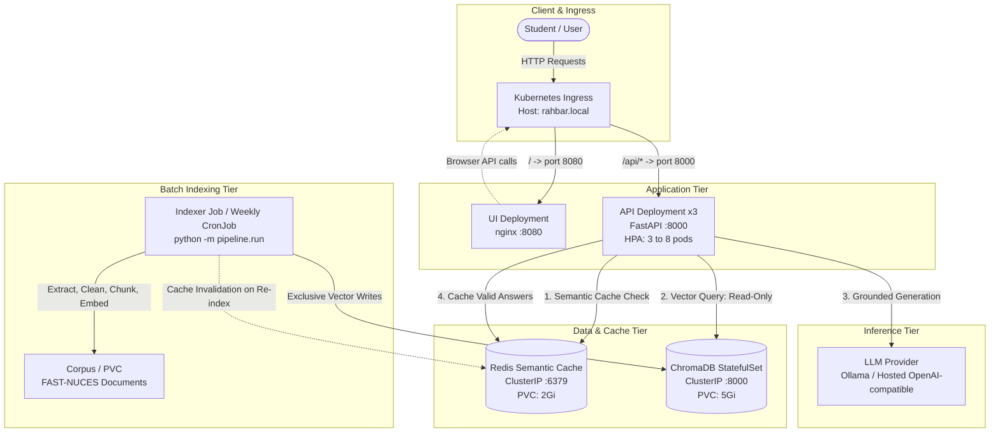

# RAHBAR AI — Grounded University RAG on Kubernetes

[](https://github.com/i243137-oss/rahbar-ai/actions/workflows/ci.yml)
[](LICENSE)

**RAHBAR** is an enterprise-grade, grounded question-answering system operating over official university regulations (FAST-NUCES). Built for high reliability, security, and scalability, RAHBAR deploys on Kubernetes with an independent batch indexing architecture, Redis-backed semantic caching, schema-constrained structured generation, and strict citation validation.

When official documents answer a question, RAHBAR quotes the exact policy with verifiable `[source, section, page]` citations. When the corpus lacks coverage, the system abstains honestly rather than hallucinating answers.

---

## Architecture Overview

RAHBAR enforces a fundamental operational boundary: **one writer, one reader, one shared pin**.
The **Indexer** runs exclusively as a batch Kubernetes Job and is the only writer to ChromaDB. The **API** deployment runs multiple replicas that operate strictly in read-only mode.



---

## Key Features

1. **Grounded & Verifiable Generation**:
   - Every claim is grounded in retrieved chunks.
   - Pydantic schema validation on model output.
   - Citation verification rejects fabricated source citations.
2. **Honest Abstention**:
   - Configurable relevance floor (`RELEVANCE_FLOOR`).
   - If retrieved context is insufficient or absent, returns `answered_from_context: false` instead of fabricating answers.
3. **Prompt-Injection Defense**:
   - Untrusted document boundaries (`<retrieved_evidence>...</retrieved_evidence>`).
   - System prompt instructs model to treat retrieved documents strictly as passive data, never following adversarial overrides.
4. **Redis Semantic Caching**:
   - Cosine similarity matching on question embeddings at threshold (`CACHE_THRESHOLD=0.90`).
   - Strict never-cache rules: abstentions, fallbacks, and conversational follow-ups are never cached.
   - Generation ID bumping invalidates cache automatically upon re-indexing.
5. **Zero-Downtime Kubernetes Deployment**:
   - API Deployment configured with 3 replicas, rolling updates (`maxUnavailable: 0`), and graceful termination.
   - CPU-based HPA automatically scaling from 3 to 8 pods.
   - Comprehensive probes: `/healthz` for liveness, `/readyz` enforcing dependency and embedding-model compatibility.
6. **Network Isolation**:
   - Calico-compatible `default-deny-all` NetworkPolicy.
   - UI pod is strictly prohibited from communicating directly with ChromaDB or Redis.

---

## API Endpoints

| Method | Path | Description | Probes & Contracts |
| :--- | :--- | :--- | :--- |
| GET | /healthz | Process liveness probe. Touches no dependencies. | Returns `200 {"status": "alive"}` |
| GET | /readyz | Readiness probe. Checks Chroma reachability, non-empty collection, Redis ping, and embedding model pin. | Returns `200` if ready, `503` if dependency or pin mismatch |
| GET | /metrics | Prometheus metrics endpoint. Exposes request latency, cache hit/miss ratio, abstentions, and fallbacks. | Content-Type: `text/plain` |
| POST | /api/ask | Question-answering endpoint. Input: `{"question": "..."}` (3 to 500 characters). | Returns `AskResponse` schema |

---

## Local Development & Setup

### Prerequisites
- Python 3.12+
- `make` and `git`
- (Optional for full container stack) Docker and Minikube

### Quickstart (Stub Mode — No Model, No Network Required)

```bash
# 1. Install dependencies
make install

# 2. Run unit and contract tests (offline)
make test

# 3. Run linting checks
make lint

# 4. Start local development server with Chat UI
make dev
```
Open [http://localhost:8000](http://localhost:8000) in your browser. The API serves the static UI with stub retriever and provider.

---

## Kubernetes Cluster Deployment Instructions

### 1. Cluster Initialization
Start Minikube with Calico CNI (required for NetworkPolicy enforcement), metrics-server (for HPA), and Ingress:

```bash
minikube start --driver=docker --cni=calico --memory=6144 --cpus=4
minikube addons enable metrics-server
minikube addons enable ingress
```

### 2. Build Container Images
Build local images and load them directly into Minikube:

```bash
make images TAG=dev
```

### 3. Create Secrets
Create the Kubernetes Secret for LLM authentication (never commit real keys to Git):

```bash
export LLM_API_KEY="your-actual-api-key"
make secret
```

### 4. Apply Manifests (Exact Apply Order)
Deploy the infrastructure using Kustomize overlays in the following exact sequence:

```bash
# Step 1: Create Namespace
kubectl apply -f k8s/base/namespace.yaml

# Step 2: Deploy ConfigMap and ServiceAccounts
kubectl apply -f k8s/base/configmap.yaml
kubectl apply -f k8s/base/serviceaccounts.yaml

# Step 3: Deploy Data Tier (Chroma StatefulSet & Redis Deployment)
kubectl apply -f k8s/base/chroma-statefulset.yaml
kubectl apply -f k8s/base/redis.yaml
kubectl apply -f k8s/base/services.yaml

# Step 4: Run Initial Indexing Job
kubectl apply -f k8s/base/indexer-job.yaml
kubectl wait --for=condition=complete job/indexer-init -n rahbar --timeout=300s

# Step 5: Deploy API, UI, Ingress, HPA, and NetworkPolicies (via dev overlay)
kubectl apply -k k8s/overlays/dev

# Step 6: Verify Deployment and Rollout Status
kubectl rollout status deployment/dev-api -n rahbar --timeout=180s
kubectl rollout status deployment/dev-ui -n rahbar --timeout=120s
```

### 5. Verify Running Endpoints & HPA

```bash
kubectl get pods,services,ingress,hpa -n rahbar
kubectl get endpoints -n rahbar
```

---

## How to Run the Indexer

The indexer is decoupled from the API. To trigger an on-demand re-index without redeploying the API:

```bash
# Trigger an index run from the CronJob template:
kubectl create job --from=cronjob/dev-reindex manual-reindex-$(date +%s) -n rahbar

# Monitor Job execution:
kubectl get jobs -n rahbar -w
kubectl logs -l app=indexer -n rahbar --tail=100 -f
```

---

## CI/CD Pipeline & Gates

The repository enforces a two-branch workflow (`dev` for active integration, protected `main` for releases):
- **`ci.yml`**: Triggers on pull requests to `main` and pushes to `dev`. Runs code linting (Ruff/Mypy), unit tests with code coverage ($\ge 60\%$), Kubernetes manifest validation with Kubeconform, Docker container builds, Trivy security vulnerability scans, and an ephemeral KinD cluster evaluation test.
- **`cd.yml`**: Triggers on push to `main`. Verified test run $\rightarrow$ builds and pushes immutable commit-SHA tagged images to Docker Hub $\rightarrow$ deploys to target cluster $\rightarrow$ waits on `kubectl rollout status` $\rightarrow$ executes automated smoke tests.

---

## Team & Responsibilities

- **Member 1 (Ahmed Tanveer)**: Document corpus, PDF/OCR extraction, text cleaning, chunking pipeline, embedding generation, ChromaDB vector storage.
- **Member 2 (Umair Hassan)**: API generation pipeline, ChromaRetriever, LLM provider integration (Ollama & Hosted), prompt safety & injection defense, citation validation, Redis semantic caching, Kubernetes architecture, Kustomize manifests, NetworkPolicies, HPA, and CI/CD automation.
