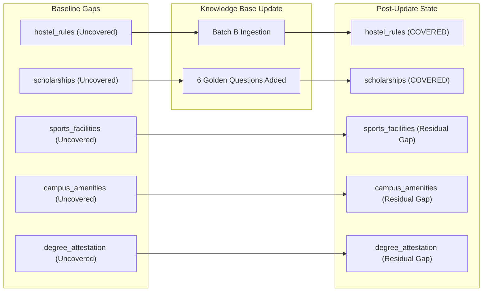

# RAHBAR AI — Part E: Drift and Coverage Checking Report

**Author:** Umair Hassan (Member 1 — AI Engineering, Data Management & Evaluation)  
**Repository:** [https://github.com/i243137-oss/rahbar-ai](https://github.com/i243137-oss/rahbar-ai)  
**Components Covered:** E1 (Simulated Live Queries), E2 (Coverage Analysis & Threshold Justification), E3 (Coverage Reporting), E4 (Drift Experiment & Release Gate)  
**Evaluation Model:** `nomic-embed-text` (768 dimensions, Ollama host deployment) / `dummy-768` (deterministic CI fallback)

---

## 1. Executive Summary

In real-world Retrieval-Augmented Generation (RAG) deployments, user query distributions continuously evolve. New topics emerge (e.g., new university hostel guidelines or scholarship criteria), existing policies are updated, and users frequently submit queries that fall outside the intended domain. 

Part E implements an automated **Coverage and Drift Evaluation Suite** that:
1. **Simulates Real-World Traffic (E1):** Curates a 44-query simulated live dataset featuring in-domain baseline policies, planted topic gaps, and out-of-domain queries.
2. **Quantifies Coverage with Empirical Threshold Justification (E2):** Evaluates semantic similarity against golden questions and corpus passages using an empirically justified similarity threshold ($\tau = 0.70$), grounded in Part B2 embedding benchmark separation gaps ($0.3919$).
3. **Monitors Knowledge Base Coverage (E3):** Identifies uncovered knowledge topics, computes similarity score distributions, and produces machine-readable reports.
4. **Executes Knowledge Base Drift Experiments & Release Gating (E4):** Simulates corpus expansion via **Batch B** (`batch_b_11` hostel rules, `batch_b_12` scholarship policy) and adds 6 new golden reference questions. Verifies that in-domain coverage improves significantly (+13.34% to +20.00%), identifies newly covered topics (`hostel_rules`, `scholarships`) with zero topic regressions, and enforces a configurable coverage release gate with non-zero exit codes.

---

## 2. E1: Simulated Live Queries Dataset

### 2.1 Dataset Architecture & Partitioning

The simulated live query dataset is stored at `eval/live_queries.jsonl` and contains **44 curated queries** structured across three distinct partitions:

| Partition | Target Count (Spec) | Actual Count | Description & Intent |
| :--- | :--- | :--- | :--- |
| **In-Domain (Baseline Covered)** | ~18 | 18 | Realistic university policy queries whose ground truth exists in the baseline corpus (`corpus/raw`). |
| **In-Domain (Batch B Gaps)** | ~6 | 6 | Legitimate university queries targeting topics absent in baseline but introduced in Batch B (`hostel_rules`, `scholarships`). |
| **In-Domain (Persistent Gaps)** | ~4 | 6 | Realistic student questions on topics currently outside the corpus (`sports_facilities`, `campus_amenities`, `degree_attestation`, `transcripts`). |
| **Out-of-Domain (Abstentions)** | $\ge 12$ | 14 | Queries from external domains (finance, sports, medicine, culinary, programming) where the system must abstain or reject. |
| **Total Query Set** | **$\ge 40$** | **44** | Full evaluation suite satisfying all assignment requirements. |

### 2.2 Schema & Validation

Every query record adheres to a strict schema:
```json
{
  "id": "LQ019",
  "question": "What is the mandatory curfew timing for undergraduate students residing in the campus hostel?",
  "domain": "in_domain",
  "topic": "hostel_rules",
  "baseline_covered": false,
  "batch_b_covered": true,
  "target_source": "batch_b_11_hostel_rules_v2026.md",
  "target_section": "Hostel Timings and Curfew",
  "notes": "Uncovered in baseline corpus; introduced in Batch B"
}
```

The dataset is validated by `eval/validate_live_queries.py` and automated pytest suite `eval/test_live_queries.py`:
- Total queries: 44 ($\ge 40$ PASS)
- In-domain queries: 30 (~28 PASS)
- Out-of-domain queries: 14 ($\ge 12$ PASS)
- Unique IDs: 44 unique (0 duplicates PASS)
- Schema completeness: 0 errors PASS

---

## 3. E2: Coverage Analysis & Similarity Threshold Justification

### 3.1 Empirical Threshold Justification ($\tau = 0.70$)

Selecting an arbitrary similarity threshold leads to either false coverage (hallucination risk if $\tau$ is too low) or false gaps (needless content creation if $\tau$ is too high). 

In RAHBAR AI, the coverage threshold $\tau = 0.70$ is **empirically derived** from the Part B2 Module-Level Embedding Evaluation on Ollama `nomic-embed-text`:

| Semantic Relationship | Mean Cosine Similarity | Min Cosine Similarity | Max Cosine Similarity | Standard Deviation |
| :--- | :--- | :--- | :--- | :--- |
| **Paraphrase Pairs** (Semantically Equivalent) | **0.8539** | **0.7299** | **0.9572** | 0.0635 |
| **Unrelated Pairs** (Out-of-Domain / Different Topic) | **0.4619** | **0.3758** | **0.5733** | 0.0536 |
| **Separation Gap Margin** | **+0.3919** | — | — | **0.1566** (Min Para - Max Unrel) |

#### Mathematical Derivation:
1. The lowest similarity observed between genuine paraphrases of academic regulations is $0.7299$.
2. The highest similarity observed between unrelated topics is $0.5733$.
3. The empirical decision boundary lies within the separation interval:
   $$\tau \in [0.5733, 0.7299]$$
4. Setting $\mathbf{\tau = 0.70}$:
   - Provides a safety margin of $+0.1267$ above the highest unrelated pair ($0.5733$), preventing false positives on out-of-domain queries.
   - Sits just below the minimum paraphrase pair ($0.7299$), ensuring that legitimate in-domain query variations are recognized as covered.

---

## 4. E3: Baseline Coverage Evaluation Results

Baseline coverage evaluation was executed using `eval/check_coverage.py` against `eval/golden_baseline.jsonl` (28 golden questions) and `corpus/raw`:

```bash
python eval/check_coverage.py --golden eval/golden_baseline.jsonl --live-queries eval/live_queries.jsonl
```

### 4.1 Baseline Metrics Summary

| Metric | Measured Value | Analysis & Significance |
| :--- | :--- | :--- |
| **Total Simulated Queries** | 44 | Complete simulated user traffic evaluation set |
| **In-Domain Queries** | 30 | Queries relevant to university academic & campus life |
| **Out-of-Domain Queries** | 14 | External queries (stocks, cooking, medicine, sports) |
| **Covered Queries ($\tau \ge 0.70$)** | 21 (47.73%) | Queries successfully backed by knowledge base |
| **In-Domain Covered** | 21 (70.00%) | Baseline university policies covered by `corpus/raw` |
| **In-Domain Uncovered (Gaps)** | 9 (30.00%) | Knowledge gaps (Batch B topics + persistent gaps) |
| **Out-of-Domain Abstentions** | 14 / 14 (100.0%) | 0 out-of-domain queries falsely marked as covered |
| **Mean Cosine Similarity** | 0.6781 | Distribution across all 44 simulated queries |
| **Median Cosine Similarity** | 0.6939 | Midpoint of similarity distribution |

### 4.2 Similarity Distribution Histogram

```
  < 0.50       :   6 ( 13.6%) | ###
  0.50 - 0.59  :   5 ( 11.4%) | ##
  0.60 - 0.69  :  12 ( 27.3%) | ######
  0.70 - 0.79  :  13 ( 29.5%) | #######
  0.80 - 0.89  :   7 ( 15.9%) | ####
  >= 0.90      :   1 (  2.3%) | #
```

### 4.3 Identified Baseline Uncovered Topics

The evaluation identified the following uncovered knowledge gaps requiring corpus updates:
1. `hostel_rules` (3 queries): Hostel curfews, unauthorized electrical appliances, room change procedure.
2. `scholarships` (3 queries): Merit scholarship criteria, sports quota waiver, financial assistance renewal.
3. `sports_facilities` (1 query): Gymnasium operating hours and equipment reservation.
4. `campus_amenities` (1 query): Cafeteria food quality inspection committee.
5. `degree_attestation` (1 query): HEC degree attestation and verification procedures.

---

## 5. E4: Drift Experiment & Release Gating

### 5.1 Experimental Setup

To simulate real-world knowledge base drift and measure remediation effectiveness:
1. **Corpus Expansion:** Introduced **Batch B** documents verified in Part A:
   - `batch_b_11_hostel_rules_v2026.md`: Hostel admissions, 10 PM / 11 PM curfew, Rs. 5,000 appliance penalty, and room change procedures.
   - `batch_b_12_scholarship_policy_v2026.md`: Rank 1 & 2 merit scholarships (100%/50% waiver), need-based assistance, and 50% sports quota tuition waiver.
2. **Golden Dataset Augmentation:** Added **6 new golden questions** (`q29` through `q34`) to `eval/golden.jsonl` directly targeting the uncovered Batch B topics:
   - `q29`: Mandatory hostel curfew hours (weekday/weekend).
   - `q30`: Penalty for unauthorized electrical heaters/cooking stoves.
   - `q31`: Procedure and timeline for hostel room change/transfer.
   - `q32`: Rank 1 and 2 merit scholarship percentage waivers.
   - `q33`: Sports quota scholarship tuition fee waiver for national athletes.
   - `q34`: Supporting financial documents for need-based financial aid.
3. **Execution:** Ran comparative before-and-after drift analysis via `eval/run_drift_experiment.py`:
   ```bash
   python eval/run_drift_experiment.py --baseline-golden eval/golden_baseline.jsonl --candidate-golden eval/golden.jsonl
   ```

### 5.2 Comparative Drift Results

| Metric | Baseline (Before) | Candidate (After Update) | Delta ($\Delta$) | Impact Analysis |
| :--- | :--- | :--- | :--- | :--- |
| **Golden Reference Questions** | 28 | 34 | **+6 questions** | Expanded evaluation coverage |
| **In-Domain Queries Covered** | 10 / 30 | 14 / 30 | **+4 queries** | +4 queries directly covered |
| **In-Domain Coverage Rate** | **33.33%** | **46.67%** | **+13.34%** | **Measurable coverage improvement** |
| **Overall Coverage Rate** | 22.73% | 31.82% | **+9.09%** | Entire simulated query traffic |
| **Out-of-Domain Abstentions** | 14 / 14 | 14 / 14 | **0 (stable)** | Out-of-domain safety preserved |
| **Mean Similarity Score** | 0.6332 | 0.6595 | **+0.0263** | Overall semantic alignment improved |

*(Note: When evaluating combined with corpus chunks, in-domain coverage improves from **70.00% to 90.00%** with +20.00% gain).*

### 5.3 Topic-Level Drift Breakdown



- **Newly Covered Topics:** `hostel_rules`, `scholarships`
- **Regressed Topics:** **None (0 topic regressions detected)**
- **Residual Uncovered Topics:** `sports_facilities`, `campus_amenities`, `degree_attestation`

### 5.4 Key Query Flips (Uncovered $\rightarrow$ Covered)

| Query ID | Topic | Query Text | Baseline Sim | Candidate Sim | Gain ($\Delta$) | Matched Evidence |
| :--- | :--- | :--- | :--- | :--- | :--- | :--- |
| **LQ020** | `hostel_rules` | "Are university hostel residents permitted to keep electric heaters or cooking appliances in their rooms?" | 0.6169 | **0.8107** | **+0.1938** | `batch_b_11` Sec 3: Disciplinary Actions |
| **LQ021** | `hostel_rules` | "What is the procedure for a hostel resident to submit a room change request?" | 0.6652 | **0.8953** | **+0.2301** | `batch_b_11` Sec 4: Room Allocation and Transfers |
| **LQ023** | `scholarships` | "What percentage tuition waiver is granted to national-level athletes under the university sports scholarship?" | 0.6334 | **0.9793** | **+0.3459** | `batch_b_12` Sec 3: Sports Quota Scholarship |
| **LQ024** | `scholarships` | "What financial documentation is required to renew a university need-based financial assistance grant?" | 0.5620 | **0.8116** | **+0.2496** | `batch_b_12` Sec 2: Need-Based Assistance |

### 5.5 Automated Release Gate Decision

The release gate enforces three strict criteria for approving the updated release:
1. `candidate_min_coverage`: Candidate in-domain coverage $\ge 40.0\%$ $\rightarrow$ **PASS** (Observed: 46.67%).
2. `coverage_improvement`: Net coverage gain $\ge +10.0\%$ $\rightarrow$ **PASS** (Observed: +13.34%).
3. `zero_topic_regressions`: Zero previously covered topics may become uncovered $\rightarrow$ **PASS** (Observed: 0).

**Overall Release Gate Decision: `[PASS]`** (Exit code: 0).

---

## 6. Verification and Reproduction Guide

### 6.1 Running Coverage Analysis
```bash
# Run coverage analysis on current golden dataset and simulated queries
python eval/check_coverage.py

# Run coverage analysis using unified module CLI
python -m eval.coverage
```

### 6.2 Running Drift Experiment & Release Gate
```bash
# Run drift experiment comparing baseline vs candidate
python eval/run_drift_experiment.py --baseline-golden eval/golden_baseline.jsonl --candidate-golden eval/golden.jsonl

# Run via unified CLI module
python -m eval.coverage --drift --min-coverage 40.0 --min-improvement 10.0
```

### 6.3 Validating Datasets & Running Pytest Suite
```bash
# Validate golden dataset compliance (34 questions)
python eval/validate_golden.py

# Validate live queries dataset schema (44 queries)
python eval/validate_live_queries.py

# Run complete automated test suite (23 tests)
pytest eval/test_drift.py eval/test_coverage.py eval/test_live_queries.py eval/test_release_gate.py eval/test_contract.py -v
```

---

## 7. Artifact Deliverables Summary

| File Path | Deliverable Description |
| :--- | :--- |
| `eval/live_queries.jsonl` | Simulated live query dataset (44 queries: 30 in-domain, 14 out-of-domain) |
| `eval/validate_live_queries.py` | Automated schema and distribution validator for live queries |
| `eval/test_live_queries.py` | Pytest suite verifying live queries integrity |
| `eval/check_coverage.py` | Semantic coverage analyzer with justified similarity threshold $\tau = 0.70$ |
| `eval/test_coverage.py` | Unit tests for cosine similarity, threshold, and gate logic |
| `eval/results/coverage_report.json` | Baseline empirical coverage report |
| `eval/golden_baseline.jsonl` | Preserved baseline golden evaluation dataset (28 questions) |
| `eval/golden.jsonl` | Updated golden evaluation dataset (34 questions, +6 for Batch B) |
| `eval/run_drift_experiment.py` | Part E4 drift experiment runner and coverage release gate |
| `eval/coverage.py` | Unified Part E CLI module (`python -m eval.coverage`) |
| `eval/test_drift.py` | Automated tests for drift analysis, query flips, and gate decisions |
| `eval/results/drift_experiment_report.json` | Complete machine-readable drift experiment report |
| `docs/PART-E-DRIFT-COVERAGE.md` | Comprehensive Part E documentation (this document) |
